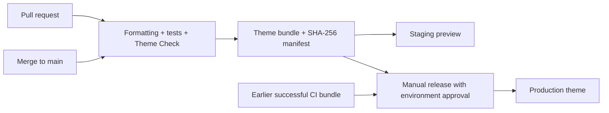

# Shopify Theme CI/CD Pipeline

A reusable Shopify theme delivery starter: check changes, build once, deploy the checked bundle to staging, and promote that same bundle to production. Rollback selects an earlier successful build.

**Status:** implemented locally; store connections and remote deployment runs still need verification. The included theme is a minimal homepage demo. For a client store, use that store’s full theme source.

## Workflow: setup once, then use for each change

This project is for **Shopify theme development**. You write the theme code; the pipeline checks it and uploads approved versions to Shopify.

### 1. Add it to your theme project — once

Keep your existing theme code. Add this project's `.github/workflows/`, `scripts/`, and `tests/` files. Merge its package scripts, development dependencies, and configuration into your existing project rather than overwriting them. Keep unrelated workflows and scripts already in your project.

The pipeline expects this structure:

```text
your-theme-project/
├── .github/workflows/   GitHub automation
├── scripts/            Packaging and deployment tools
├── tests/              Pipeline tests
├── theme/              Your actual Shopify theme
│   ├── assets/
│   ├── config/
│   ├── layout/
│   ├── sections/
│   └── templates/
├── .nvmrc
├── package.json
└── package-lock.json
```

If your theme lives elsewhere, adapt the paths before using the pipeline. The included `theme/` is only a demo; use the store's actual theme for client work.

### 2. Connect Shopify and GitHub — once

1. Prepare an unpublished **staging** theme for testing and a separate **production** target theme. Each target must already contain the complete theme.
2. Generate a password using Shopify's **Theme Access** app.
3. In GitHub, create `staging` and `production` environments. Set each environment's `SHOPIFY_STORE`, `SHOPIFY_THEME_ID`, and secret `SHOPIFY_CLI_THEME_TOKEN`.
4. Add repository variable `ENABLE_STAGING=true` to turn on automatic staging uploads.
5. Configure production reviewers where available and protect `main` with the **Theme quality** check.

Follow [the setup guide](docs/setup.md) for exact settings and commands. By default, deployment preserves merchant-edited JSON templates and settings; decide their ownership before deploying layout changes.

### 3. Make a change — every time

Create a branch from your updated `main`:

```sh
git switch main
git pull --ff-only
git switch -c update-banner
```

Edit files inside `theme/`, then run:

```sh
npm ci
npm run format
npm test
npm run check
```

Preview your change on the development store using the command under **Local commands** below.

### 4. Push and open a pull request

```sh
git add .
git commit -m "Update promotional banner"
git push -u origin update-banner
```

Open a pull request on GitHub. **GitHub automatically checks formatting, runs pipeline tests, and checks the theme code.** Fix any failures before merging.

### 5. Merge and test staging

Merge the passing pull request into `main`. **GitHub automatically packages that version and uploads it to staging** when staging is enabled and configured.

Open the staging theme preview in Shopify and check the changed pages. Merging does not automatically update your production theme.

### 6. Release the tested version

Open the successful main-branch **Theme CI** run and copy its numeric run ID from the URL. In **Actions → Release or rollback → Run workflow**, select `main`, enter that run ID, and confirm the production theme ID.

Select **Allow updating the live theme** only when your target is live. Approve the deployment if prompted. GitHub uploads the original checked bundle to production. Verify the result in Shopify. Updating an unpublished production demo theme does not publish it.

### 7. Roll back if needed

Run **Release or rollback** again with an earlier successful CI run ID and the same target confirmation. GitHub redeploys that earlier bundle. Check the storefront afterward; rollback restores deployed theme code, not store data or merchant settings.

**Everyday flow:** edit → pull request → checks pass → merge → preview staging → manual release. Use an earlier successful build to roll back.



## Local commands

Use Node.js 22.12 or later. Node 22 is selected in CI.

```sh
npm ci
npm run format:check
npm test
npm run check
npm run package
npm run verify:bundle
```

Run `npm run format` to fix formatting. Theme Check validates Liquid; Prettier checks the other supported files. Packaging needs Git and at least one commit. Local packages include local edits; only clean GitHub CI push builds are eligible for promotion.

Preview on your development store:

```sh
npm run dev -- --store your-store.myshopify.com
```

The CLI guides authentication. See [setup](docs/setup.md) for the full connection steps and adopting an existing theme.

## What the starter handles

- Pinned Node tooling and GitHub Actions commits, plus Dependabot update requests.
- Pull request checks without Shopify credentials.
- CI artifacts with commit, run ID, and SHA-256 file hashes.
- Production promotion of an existing successful `main` push build. No source rebuild during release or rollback.
- Rejection of failed builds, PR builds, fork builds, unexpected workflows, and altered bundles.
- Named store and numeric theme ID validation, target-role checks, and an explicit live-theme opt-in.
- Production target confirmation and GitHub environment integration.
- Staging concurrency and a check that rejects deployments already behind `main`.
- Deployment summaries identifying the source commit, CI run, store, and theme.

## Theme editor ownership

Default deployment preserves:

- `config/settings_data.json` — never packaged or deployed.
- `templates/*.json` and `templates/customers/*.json`.
- `sections/*.json` — section groups.
- Remote files absent from Git, using Shopify CLI’s `--nodelete`.

This keeps merchant-edited layouts and section settings out of routine code releases. It also means new or edited JSON templates do not deploy by default. Bootstrap a new demo theme manually with the complete source before using the pipeline.

If your team explicitly manages template and section-group JSON in Git, set environment variable **`MANAGE_THEME_EDITOR_JSON=true`** in the relevant GitHub environment. Those JSON files will then deploy and overwrite remote edits. Global `settings_data.json` stays excluded. Reconcile merchant edits before switching ownership.

Because deployments do not delete remote files, removed or renamed files require a separate reviewed cleanup. A rollback restores the earlier bundle’s deployed files; it is not a complete remote snapshot restore.

## Release and rollback

1. Open a successful **Theme CI** run triggered by a push to `main`.
2. Copy its numeric run ID from the URL: `/actions/runs/123456789`.
3. Open **Release or rollback → Run workflow** on `main`.
4. Enter the run ID and production theme ID.
5. Leave **Allow updating the live theme** off for an unpublished demo target. Select it only when deliberately updating a live theme.
6. Approve the `production` environment if configured and verify the storefront.

To roll back, repeat with an earlier successful run ID. The workflow downloads that original bundle and checks its manifest. It does not install the old theme’s dependencies or rebuild the theme source. Deployment tooling still uses the current workflow revision.

Artifacts are requested for 90 days, subject to repository limits. Deleted, expired, failed, legacy bundles without a manifest, and commits removed from `main` cannot be promoted. Keep release artifacts longer through an explicit archival process if the store needs a longer rollback window.

## Limits and setup requirements

Configure reviewers and branch restrictions on the production environment; the workflow alone cannot require human approval. Restrict deployments to `main`, protect that branch, and require **Theme quality**. Availability of environment protection features depends on GitHub plan and repository visibility.

Theme-role checks run before upload, and Shopify CLI also blocks live pushes without the explicit flag. Staging checks the latest main commit before upload; a merge arriving during an upload can still change which version is newest. Inspect the deployment summary after rapid merges.

An upload can fail partway through. Preview the result and rerun a known-good build when necessary. Merchant settings, products, orders, and app state are not restored. Renamed/deleted files remain on the remote theme until intentionally cleaned up.

This is a practical starting point for a professional workflow, not a universal agency standard. Store-specific browser/cart checks, visual regression tests, and Lighthouse budgets should be configured against the actual storefront before relying on it for client releases. They are not included or claimed as passing here.

## Portfolio evidence

Record actual pull request failures and fixes, CI bundles, staging previews, releases, and rollback runs in [demo evidence](docs/demo-evidence.md).

Repository: [Shopify-Theme-CI-CD-Pipeline](https://github.com/rjaybernardo/Shopify-Theme-CI-CD-Pipeline). Include `package-lock.json` when committing: CI requires it.

## Related Shopify theme projects

Shopify theme projects from [my GitHub profile](https://github.com/rjaybernardo). Each repository contains theme files relevant to this pipeline. The pipeline has not been installed or tested in these repositories.

These repositories contain Shopify theme files. They are candidates for adapting this theme pipeline after reviewing their structure and deployment setup.

| Project            | Repository                                                                             |
| ------------------ | -------------------------------------------------------------------------------------- |
| RGB Leather        | [rgb-leather-shopify-theme](https://github.com/rjaybernardo/rgb-leather-shopify-theme) |
| Ecomos             | [ecomos-shopify-theme](https://github.com/rjaybernardo/ecomos-shopify-theme)           |
| Dropship theme     | [shopify-dropship-theme](https://github.com/rjaybernardo/shopify-dropship-theme)       |
| Ecommerce theme    | [ecommerce-shopify-theme](https://github.com/rjaybernardo/ecommerce-shopify-theme)     |
| Noble Origins      | [noble-origins-shopify](https://github.com/rjaybernardo/noble-origins-shopify)         |
| Forex client theme | [shopify-forex-client](https://github.com/rjaybernardo/shopify-forex-client)           |
| Kayani             | [Kayani](https://github.com/rjaybernardo/Kayani)                                       |
| Theme boilerplate  | [shopify-boilerplate-theme](https://github.com/rjaybernardo/shopify-boilerplate-theme) |
| General theme      | [shopify-general-theme](https://github.com/rjaybernardo/shopify-general-theme)         |
| TBG USA            | [tbg-usa](https://github.com/rjaybernardo/tbg-usa)                                     |
| Slugg Australia    | [slugg-au](https://github.com/rjaybernardo/slugg-au)                                   |
| Slugg USA          | [slugg-usa](https://github.com/rjaybernardo/slugg-usa)                                 |

## References

- [Shopify CLI in CI/CD](https://shopify.dev/docs/storefronts/themes/tools/cli/ci-cd)
- [Shopify Theme Check](https://shopify.dev/docs/storefronts/themes/tools/theme-check)
- [GitHub workflow artifacts](https://docs.github.com/en/actions/how-tos/manage-workflow-runs/download-workflow-artifacts)
- [GitHub deployment environments](https://docs.github.com/en/actions/how-tos/deploy/configure-and-manage-deployments/manage-environments)
