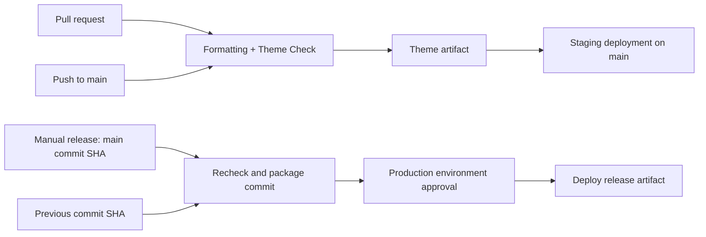

# Shopify Theme CI/CD Pipeline

A portfolio project that checks a Shopify theme, packages the checked files, deploys them to staging, and supports manual releases and rollbacks by commit SHA.

**Status:** local starter implemented. GitHub workflow runs and store deployments still need account setup and verification. This is a minimal homepage and 404 demo theme, not a complete commerce theme or a Theme Store submission.

## Delivery flow



## Local setup

Use Node.js 22.12 or later. Node 22 is selected in CI.

```sh
npm ci
npm run check
npm run format:check
npm run package
```

Dependencies are pinned and locked. `npm run check` fails on Theme Check warnings as well as errors. Formatting checks cover supported files; Liquid is checked by Theme Check rather than Prettier.

To preview on a development store, replace the example domain:

```sh
npm run dev -- --store your-store.myshopify.com
```

The CLI will guide you through authentication. The homepage banner can be edited in the theme editor. Choose a button link in its settings to display the button.

## GitHub setup

Publish this folder as the repository root so `.github/workflows` and `package-lock.json` are at the top level. Do not publish the parent job-hunt workspace.

Create a GitHub repository named `shopify-theme-cicd`, then push this project with `main` as the default branch. The **Theme CI** workflow runs on pull requests and pushes to `main` without Shopify credentials. Configure a branch protection rule requiring **Theme quality** before merging, and prevent direct pushes to `main`.

Create two GitHub environments: `staging` and `production`. Configure these values separately in each environment:

| Kind | Name | Value |
| --- | --- | --- |
| Variable | `SHOPIFY_STORE` | Your `example.myshopify.com` domain |
| Variable | `SHOPIFY_THEME_ID` | Numeric ID of the target theme |
| Secret | `SHOPIFY_CLI_THEME_TOKEN` | Password generated by Shopify's Theme Access app |

Use dedicated demo themes. The staging theme must be unpublished; its workflow does not permit writing to a live theme. For production, the workflow updates the configured theme, including a live theme, but does not automatically publish an unpublished theme. Select the demo production theme as live in Shopify if you want releases visible at the storefront URL.

Add required reviewers to the `production` environment before using releases. Environment approval depends on your GitHub plan and repository visibility; without that configuration the workflow runs immediately when dispatched. Restrict production deployments to `main` and dispatch the workflow from `main`.

Finally, add a **repository variable** `ENABLE_STAGING` with value `true`. Until enabled, CI still runs and staging is skipped. Never put passwords in files, commits, or screenshots.

## Release and rollback

1. Merge a change to `main` and confirm **Theme quality** succeeds. If staging is configured, preview the staging theme in Shopify.
2. Copy the full 40-character commit SHA from `main`.
3. In GitHub Actions, select **Release or rollback**, choose **Run workflow** from `main`, and enter that SHA.
4. The workflow verifies that the commit belongs to `main`, reruns quality checks, and packages it. Approve the production environment deployment when requested.
5. Confirm the demo storefront and inspect the deployment job summary.

To roll back, run the same workflow with the SHA of a previously working commit. This revalidates and redeploys the previous theme source; it does not reuse a historical build. A previous commit whose dependency installation or checks fail cannot be deployed through this workflow until resolved.

Both workflows deploy the artifact produced by their validation job. Production deployments are serialized. Staging deployments are also serialized, though GitHub concurrency does not promise FIFO ordering; verify the deployed SHA after rapid merges.

`config/settings_data.json` is excluded from deployment to preserve store-managed global settings. Other theme files, including template JSON and their section settings, are managed by Git. Deployment can remove remote theme files absent from this minimal source. Rollback restores code, not products, orders, app state, merchant settings, or database content.

## Portfolio demonstration

Record these examples after configuring GitHub and your development store:

- A pull request with a Liquid error that fails Theme Check, followed by the fix.
- A passing run with a downloadable `theme-<commit>` artifact.
- A banner change deployed to the staging theme after merging.
- A manual production release and a rollback to the previous banner.

Save screenshots and links in `docs/demo-evidence.md`. Describe only the checks and deployments you have actually run. Lighthouse and browser smoke tests are possible follow-up work once a store preview is available; they are not implemented yet.

## Project structure

```text
.github/workflows/ci.yml        Quality checks, artifact, optional staging
.github/workflows/release.yml   Manual release and rollback
scripts/package-theme.mjs      Prepare the deployable theme directory
theme/                         Minimal original Shopify theme
docs/demo-evidence.md           Portfolio evidence checklist
```

## References

- [Shopify CLI in CI/CD](https://shopify.dev/docs/storefronts/themes/tools/cli/ci-cd)
- [Shopify Theme Check](https://shopify.dev/docs/storefronts/themes/tools/theme-check)
- [GitHub deployment environments](https://docs.github.com/en/actions/how-tos/deploy/configure-and-manage-deployments/manage-environments)
